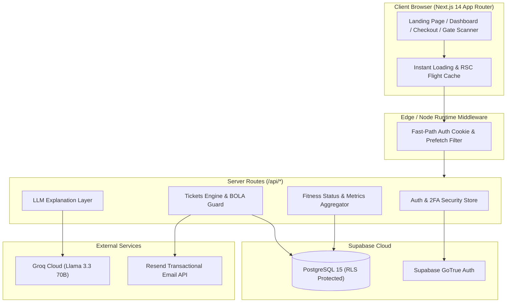

<p align="center">
  
</p>

<p align="center">
  <strong>Platform E-Ticket Event Lari Modern & Deterministic Smart Distance Recommendation</strong>
</p>

<p align="center">
  <a href="https://nextjs.org"></a>
  <a href="https://www.typescriptlang.org"></a>
  <a href="https://tailwindcss.com"></a>
  <a href="https://supabase.com"></a>
  <a href="https://groq.com"></a>
  
</p>

---

## 📌 Tentang StrideTix

**StrideTix** adalah platform *ticketing* lomba lari modern yang memadukan ekosistem penerbitan tiket resmi dengan **Rule-Based Scoring Engine** dan **LLM Explanation Layer** berbasis Groq Cloud API. 

Platform ini dirancang khusus untuk mencegah cedera fisik akibat pemaksaan jarak yang belum siap ditempuh oleh pelari (*over-distance injury*), sekaligus menyederhanakan operasional penyelenggara lomba (*Event Organizer*) dalam memverifikasi peserta di *Start Gate*.

---

## ✨ Fitur Unggulan

### 🏃 1. Smart Distance Recommendation
* **Deterministic Rule-Based Scoring:** Rekomendasi kategori jarak lari (5K, 10K, Half Marathon, Full Marathon) dihitung menggunakan algoritma deterministik matematis murni berdasarkan volume mingguan, *longest run*, *average pace*, dan skor konsistensi.
* **LLM Personalization Layer:** Groq Cloud API memberikan narasi analisis personal, saran kesiapan fisiologis, dan tips latihan tanpa mengubah kategori rekomendasi deterministik yang telah terkunci.
* **Multi-Source Fitness Sync:** Mendukung input manual, unggah log latihan CSV/GPX, serta persiapan integrasi Strava API v3.

### 🎫 2. E-Ticket & Vector PDF Engine
* **Dynamic E-Ticket Pass:** Tiket digital interaktif lengkap dengan nomor BIB resmi, jadwal flag-off, kategori lomba, dan detail venue.
* **Native Vector PDF Download:** Generator PDF berbasis `@react-pdf/renderer` dengan modul yang dimuat secara *on-demand (lazy chunk)* untuk memastikan tiket dapat diunduh tanpa distorsi visual resolusi tinggi.
* **Resend Confirmation:** Pengiriman ulang e-ticket ke email peserta via Resend API dengan proteksi validasi BOLA (*Broken Object Level Authorization*).

### 📱 3. Live Organizer Gate Terminal
* **In-Browser Camera Scanner:** Modul QR Scanner berbasis `html5-qrcode` yang dimuat secara dinamis saat dibuka (*zero initial bundle penalty*).
* **Double Check-in Prevention:** Validasi status tiket secara instan dengan efek suara audio beep dan peringatan visual saat tiket ganda terdeteksi di pintu gerbang.

### 🛡️ 4. Enterprise-Grade Security & Performance
* **OWASP Hardened:** Dilengkapi mitigasi terhadap CWE-307 (*brute-force rate limiting* dengan sistem sliding window dan lockout setelah 5x kegagalan OTP), CWE-200 (*anti-user enumeration*), dan CWE-532 (*masking token sensitif di server log*).
* **Instant Menu Transitions:** Dioptimalkan dengan *Instant Route Boundaries* Next.js 14 (`loading.tsx`), *parallel queries* (`Promise.all`), dan pembersihan dependensi mati sehingga navigasi menu merespons instan di bawah 500 ms.

---

## 🏗️ Arsitektur Sistem



---

## 💻 Tech Stack

| Komponen | Teknologi | Keterangan |
| :--- | :--- | :--- |
| **Framework** | Next.js 14 (App Router) | Server Components, Route Handlers, ISR |
| **Bahasa** | TypeScript 5.6 | Strict Type Safety |
| **Styling** | Tailwind CSS + Lucide Icons | Palet warna hangat (Warm Sand & Vibrant Orange) |
| **Database & Auth** | Supabase (PostgreSQL + Auth) | RLS Policies, SSR Cookie Management |
| **AI Explanation** | Groq Cloud API | Llama 3.3 70B Versatile |
| **QR Code Engine** | `qrcode.react` & `html5-qrcode` | Live Camera Scanning & Vector Generation |
| **PDF Generation** | `@react-pdf/renderer` | High-fidelity Vector Ticket Pass |
| **Transactional Mail**| Resend API | Pengiriman E-Ticket dan OTP 2FA |

---

## 🚀 Panduan Memulai (Quick Start)

### 1. Prasyarat Sistem
* [Node.js](https://nodejs.org/) v18.18.0 atau yang lebih baru
* Akun [Supabase](https://supabase.com/) dengan proyek aktif
* API Key [Groq Cloud](https://console.groq.com/)

### 2. Kloning Repositori
```bash
git clone https://github.com/your-username/stridetix.git
cd stridetix
```

### 3. Instalasi Dependensi
```bash
npm install
```

### 4. Konfigurasi Environment Variables
Salin file `.env.example` ke `.env.local` dan lengkapi kredensial Anda:
```bash
cp .env.example .env.local
```

Isi konfigurasi berikut di dalam `.env.local`:
```env
# Supabase Configuration
NEXT_PUBLIC_SUPABASE_URL=https://your-project.supabase.co
NEXT_PUBLIC_SUPABASE_ANON_KEY=your-anon-key
SUPABASE_SERVICE_ROLE_KEY=your-service-role-key

# Groq Cloud API
GROQ_API_KEY=gsk_your_groq_api_key

# Transactional Email (Resend)
RESEND_API_KEY=re_your_resend_api_key
EMAIL_FROM="StrideTix <no-reply@yourdomain.com>"
```

### 5. Menjalankan Server Development
```bash
npm run dev
```
Buka [http://localhost:3000](http://localhost:3000) di browser Anda untuk melihat aplikasi berjalan.

### 6. Build Produksi & Typecheck
```bash
# Validasi tipe TypeScript
npx tsc --noEmit

# Validasi linter kode
npm run lint

# Kompilasi bundel produksi
npm run build

# Menjalankan server produksi lokal
npm run start
```

---

## 📁 Struktur Direktori

```text
stridetix/
├── public/                 # Aset statis & logo merek resmi
│   └── brand/             # Berkas SVG (lockup, simbol, favicon)
├── src/
│   ├── app/               # Next.js App Router (Routes & API Endpoints)
│   │   ├── admin/         # Portal Administrator & Tata Kelola
│   │   ├── api/           # Route Handlers (/api/auth, /api/tickets, dll.)
│   │   ├── checkout/      # Alur Pemesanan & Pembayaran Tiket
│   │   ├── dashboard/     # Portal Profil & Pengaturan Pelari
│   │   ├── organizer/     # Portal Penyelenggara & Gate Check-in
│   │   ├── smart-ai/      # Halaman Smart Distance Recommendation
│   │   ├── tickets/       # Halaman Manajemen Tiket & Detail E-Ticket
│   │   └── loading.tsx    # Instant Route Transition Boundary
│   ├── components/        # Komponen UI Modular (Desain Standar < 500 Baris)
│   ├── context/           # React Context (AuthContext, RunnerContext)
│   ├── lib/               # Utility, Scoring Engine, & Rate Limiter
│   ├── services/          # Abstraksi Pemanggilan Layanan Backend
│   ├── types/             # Definisi Tipe TypeScript
│   └── utils/             # Helper Mandiri (ticketCode, ticketPdf, Supabase)
├── AGENTS.md              # Aturan Wajib Coding & Batasan Modularitas
├── design.md              # Design System & Style Guidelines
├── prd.md                 # Product Requirement Document (SSOT)
└── techstack.md           # Standar Spesifikasi Teknologi
```

---

## 📜 Kebijakan & Aturan Kode (`AGENTS.md`)

Setiap kontribusi atau perubahan kode pada proyek ini **wajib mematuhi 4 pilar aturan inti**:
1. **Modularitas Mutlak:** Maksimal **500 baris kode per file**. File yang mendekati limit harus segera dipecah (*single responsibility*).
2. **Deterministic vs LLM Separation:** Logika skor jarak harus deterministik pada `lib/scoring/engine.ts`. LLM hanya digunakan sebagai penjelas naratif (*Explanation Layer*).
3. **Think & Critique First:** Menilai implikasi keamanan, *user flow*, dan performa sebelum mengimplementasikan solusi.
4. **Kepatuhan SSOT:** Tunduk sepenuhnya pada dokumen acuan [`prd.md`](prd.md), [`techstack.md`](techstack.md), dan [`design.md`](design.md).

---

## 📄 Lisensi

Didistribusikan di bawah lisensi MIT. Lihat berkas `LICENSE` untuk informasi lebih lanjut.
