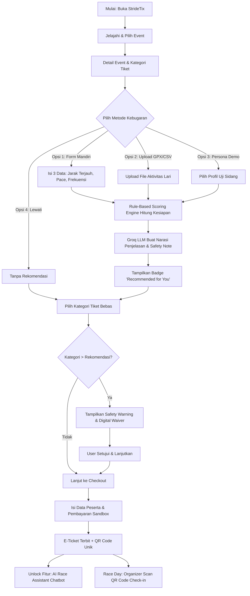

# Product Requirements Document (PRD)
# StrideTix: Platform E-Ticket Event Lari dengan Smart Distance Recommendation

- **Versi:** 1.1
- **Tanggal:** 2026-10-29
- **Status:** Review (Gate Tahap 3)
- **Sumber Input:** Hasil Brainstorming PRD v1.0, Penyesuaian Scope Tugas Akhir, `profile.md`, `project-context.md`
- **Penulis:** Product Manager (Antigravity) & Lead Builder

---

## 1. TL;DR

StrideTix adalah platform web e-ticketing khusus event lari yang mengintegrasikan **Smart Distance Recommendation** (hibrida Rule-Based Scoring Engine + LLM Explanation) untuk mencegah pelari salah memilih jarak lomba (menekan risiko cedera/DNF). Pengguna dapat memasukkan data kebugaran via formulir mandiri 3 pertanyaan instan (jarak terjauh, pace nyaman, frekuensi), upload GPX/CSV, atau preset persona simulator. Sistem bersifat **mitigasi, bukan restriksi** (pengguna tetap dapat membeli jarak di atas rekomendasi dengan menyetujui *safety warning/digital waiver*). Sebagai diferensiasi dan efisiensi token, **AI Running Assistant (Chatbot) dikunci khusus bagi pemegang tiket aktif (*Post-Purchase Race Assistant*)**. Modul Admin disederhanakan menjadi *Executive KPI Dashboard* untuk kesiapan startup dan efisiensi pengerjaan solo vibecoding.

---

## 2. Konteks dan Problem Statement

### 2.1 Analisis Akar Masalah (5 Whys)

```
Gejala: Banyak pelari (khususnya pemula/rekreasi) mengalami cedera atau Did Not Finish (DNF) saat event lari resmi.
Why 1: Mereka memilih kategori jarak (10K/Half Marathon/Full Marathon) yang melampaui kesiapan fisik mereka. [Observasi komunitas & tren race]
Why 2: Saat mendaftar di platform ticketing, mereka hanya melihat faktor gengsi, FOMO, atau teman, tanpa ada panduan kesiapan objektif. [Asumsi teredukasi]
Why 3: Platform ticketing umum (Tiket.com, Loket, Google Form) hanya berfokus pada kelancaran transaksi checkout dan penjualan tiket. [Fakta industri]
Why 4: Platform ticketing tidak pernah meminta atau menganalisis data riwayat aktivitas latihan pelari sebelum transaksi. [Fakta industri]
Akar Masalah: Ketiadaan integrasi antara analisis data latihan pelari dan proses pemilihan kategori tiket pada platform e-ticketing.
```

### 2.2 Problem Statement
> **Pelari pemula dan rekreasi** sering mengalami **salah pemilihan kategori jarak lomba** ketika **mendaftar event lari**, yang menyebabkan **risiko cedera fisik, kelelahan ekstrem, dan kegagalan menyelesaikan lomba (DNF)**.
> 
> Saat ini mereka mengatasinya dengan **menebak-nebak kemampuan sendiri atau mengikuti pilihan teman**, yang **sering kali tidak akurat dan membahayakan keselamatan pelari di hari perlombaan**.

- **Bukti:** Pengamatan pada tren lonjakan peserta event lari nasional dan maraknya kasus medis di lintasan akibat kurangnya latihan long run terstruktur.
- **Yang Belum Divalidasi `[ASUMSI]`:** Pengguna bersedia meluangkan waktu 10-15 detik untuk mengisi 3 pertanyaan formulir mandiri sebelum memilih tiket jika dijelaskan manfaat rekomendasinya.

---

## 3. Goals dan Success Metrics

### 3.1 Tujuan Produk
1. Membantu pelari memilih kategori jarak yang realistis dan aman sesuai riwayat fisiknya.
2. Menyediakan proses pembelian tiket e-ticket yang cepat, aman, dan menerbitkan QR Code unik.
3. Memberikan nilai tambah pasca-pembelian berupa AI Chatbot yang bertindak sebagai *Personal Race Prep Coach*.
4. Memudahkan organizer memvalidasi tiket peserta via scanner QR Code web.
5. Menyajikan metrik bisnis dan kepatuhan keselamatan secara terpusat bagi pengelola platform (Admin).

### 3.2 Success Metrics (KPI Tugas Akhir / MVP)

| Metrik | Target MVP | Dasar Penentuan / Bukti |
|---|---:|---|
| Keberhasilan alur pemesanan tiket | ≥ 95% | Pengujian fungsional skenario end-to-end |
| Tingkat adopsi rekomendasi mandiri | ≥ 70% | Dari responden uji coba yang mengisi form mandiri |
| Waktu pengisian form mandiri | ≤ 15 detik | 3 input sederhana (Jarak, Pace, Frekuensi) |
| Waktu inferensi rekomendasi & penjelasan | ≤ 5 detik | Rule engine lokal + Groq LPU API |
| Ketepatan klasifikasi jarak | ≥ 90% | Uji validasi 4 skenario persona terkalibrasi |
| Keberhasilan pemindaian QR Code | 100% | Single-use scan pada tiket berbayar valid |
| Penghematan token AI Chatbot | 100% dari non-buyer | Gating ketat hanya untuk user dengan tiket aktif |

---

## 4. Target Users

### 4.1 Runner Pemula & Rekreasi (Primary)
- **Deskripsi:** Pelari yang baru berlari 1-6 bulan, ingin mencoba event lomba (5K/10K/HM).
- **Need:** Bantuan mengetahui apakah tubuhnya sudah siap untuk jarak tertentu tanpa harus konsultasi mahal ke pelatih lari.
- **Context:** Sering bingung memilih antara 5K atau 10K, tidak memiliki smartwatch canggih atau file GPX.

### 4.2 Runner Enthusiast / Berpengalaman
- **Deskripsi:** Pelari rutin yang memiliki riwayat lari teratur, menargetkan HM atau FM.
- **Need:** Validasi kesiapan volume latihan mingguan dan panduan persiapan race day personal.
- **Context:** Memiliki jam lari (Garmin/Coros/Apple) dan mampu mengekspor file GPX/CSV.

### 4.3 Event Organizer
- **Deskripsi:** Penyelenggara event lari yang menjual kuota tiket lomba.
- **Need:** Manajemen kuota per kategori, daftar peserta, dan alat validasi tiket di lokasi race (*check-in counter*).
- **Context:** Butuh sistem pemindaian QR Code yang cepat dan anti-duplikasi saat *race pack collection* atau *race day*.

### 4.4 Platform Operator / Startup Admin
- **Deskripsi:** Pengelola platform StrideTix (mahasiswa/founder).
- **Need:** Memantau metrik bisnis (transaksi, tiket terjual) dan metrik kepatuhan rekomendasi (*safety compliance rate*).
- **Context:** Membutuhkan ringkasan analitik satu layar (*executive dashboard*) untuk evaluasi produk dan bahan presentasi sidang.

---

## 5. User Journey & Arsitektur Alur



---

## 6. User Stories & Acceptance Criteria

### 6.1 Modul Runner & Rekomendasi

#### US-01: Penilaian Kebugaran Mandiri Cepat (Self-Assessment)
> Sebagai pelari pemula, saya ingin mengisi 3 pertanyaan singkat tentang kebiasaan lari saya agar mendapatkan rekomendasi jarak tanpa memerlukan jam tangan pintar.

**Acceptance Criteria:**
- Sistem menyediakan form input: Jarak lari terjauh (KM), Pace rata-rata paling nyaman (menit:detik/km), dan Frekuensi lari mingguan (angka 1-7).
- Waktu pengisian dirancang selesai di bawah 15 detik.
- Validasi input mencegah nilai tak wajar (jarak < 0 atau > 100 km, pace < 2 min/km atau > 20 min/km).
- Hasil input langsung diproses oleh Scoring Engine tanpa perlu reload halaman.

#### US-02: Rekomendasi Jarak Cerdas (Hybrid Engine)
> Sebagai calon peserta lomba, saya ingin melihat rekomendasi kategori jarak beserta alasan penjelasannya agar saya yakin dengan pilihan saya.

**Acceptance Criteria:**
- Kategori rekomendasi (5K / 10K / HM / FM / Insufficient Data) ditentukan secara deterministik oleh Rule-Based Engine.
- LLM (Groq API) menyusun narasi penjelasan 2-3 kalimat yang ramah dan kontekstual berdasarkan metrik pengguna.
- Sistem menampilkan tingkat kesiapan (*Readiness Level*) dan estimasi *Confidence*.
- Kategori event yang sesuai di antarmuka diberi lencana visual **Recommended for You**.

#### US-03: Safety Warning & Digital Waiver (Mitigasi Non-Restriktif)
> Sebagai pengguna yang memilih jarak di atas rekomendasi, saya ingin menerima peringatan risiko dan opsi konfirmasi tanggung jawab agar saya tetap memiliki kebebasan memilih secara sadar.

**Acceptance Criteria:**
- Jika pengguna memilih kategori di atas hasil rekomendasi (misal hasil: 5K, dipilih: Half Marathon), modal peringatan keselamatan muncul.
- Peringatan menjelaskan kesenjangan latihan dan risiko fisik tanpa membuat vonis medis.
- Tombol lanjut hanya aktif setelah pengguna mencentang persetujuan *digital waiver* ("Saya memahami risiko fisik dan menyatakan bertanggung jawab secara mandiri").
- Sistem mencatat status *safety override* pada transaksi pemesanan.

#### US-04: Pembelian Tiket & Penerbitan E-Ticket QR
> Sebagai peserta lomba, saya ingin menyelesaikan pemesanan dan memperoleh tiket digital dengan QR Code agar dapat digunakan saat check-in lomba.

**Acceptance Criteria:**
- Transaksi diproses via simulasi pembayaran (Sandbox).
- Setelah status pembayaran sukses, sistem menerbitkan E-ticket unik dengan kode QR.
- QR Code berisi payload token terenkripsi/hash aman (bukan data mentah PII peserta).
- Tiket tersimpan di halaman "Tiket Saya".

#### US-05: AI Race Assistant (Post-Purchase Gated)
> Sebagai pemegang tiket aktif, saya ingin berkonsultasi dengan asisten AI seputar persiapan event lomba yang saya ikuti agar saya siap fisik dan mental di hari perlombaan.

**Acceptance Criteria:**
- Chatbot hanya dapat diakses oleh akun yang memiliki tiket berstatus aktif/paid.
- Sistem menyuntikkan (*inject*) konteks otomatis ke system prompt: Nama event, kategori jarak tiket, tanggal lomba, dan profil kebugaran pengguna.
- Chatbot menjawab seputar: hidrasi, nutrisi race week, perlengkapan lomba, checklist h-1, dan strategi pacing.
- **Guardrails:** Chatbot secara tegas menolak memberikan diagnosis medis atau menyarankan mengabaikan cedera fisik.

---

### 6.2 Modul Organizer & Check-in

#### US-06: Manajemen Kuota & Kategori Event
> Sebagai event organizer, saya ingin mengatur kuota peserta dan harga pada setiap kategori jarak agar penjualan tiket terkontrol.

**Acceptance Criteria:**
- Organizer dapat mengatur harga dan batas kuota untuk kategori 5K, 10K, HM, FM.
- Kuota berkurang secara otomatis ketika ada pembayaran berhasil.
- Kategori dengan sisa kuota 0 otomatis berlabel *Sold Out* dan tidak dapat dipilih.

#### US-07: Validasi Tiket Scanner di Lokasi Event
> Sebagai panitia lomba, saya ingin memindai QR Code tiket peserta menggunakan kamera perangkat agar proses registrasi ulang (*check-in*) cepat dan bebas kecurangan.

**Acceptance Criteria:**
- Halaman scanner dapat mengakses kamera web/smartphone organizer.
- Sistem memvalidasi keaslian token tiket dalam waktu ≤ 2 detik.
- Tiket valid yang belum dipakai menampilkan info peserta dan otomatis berubah status menjadi `Checked-in`.
- Tiket yang sudah pernah di-scan ditolak dengan indikator visual merah: "Tiket Sudah Digunakan".

---

### 6.3 Modul Admin / Startup Operator

#### US-08: Executive & KPI Analytics Dashboard
> Sebagai platform owner, saya ingin memantau metrik performa produk dan keselamatan pelari dalam satu layar agar dapat mengevaluasi efektivitas bisnis dan rekomendasi.

**Acceptance Criteria:**
- Menampilkan metrik utama: Total Pendapatan/Transaksi, Tiket Terjual per Kategori.
- Menampilkan metrik adopsi: % Pengguna yang mengisi data kebugaran vs yang *skip*.
- Menampilkan metrik *Safety Compliance*: Rasio peserta yang patuh rekomendasi vs peserta yang melakukan *safety override*.
- Dilengkapi daftar log aktivitas transaksi sistem terbaru.

---

## 7. Functional Requirements

### 7.1 Autentikasi & Akun
- **FR-AUTH-01:** Sistem HARUS menyediakan registrasi dan login berbasis email/password dengan enkripsi hash aman.
- **FR-AUTH-02:** Sistem HARUS mendukung 3 hak akses peran: `Runner`, `Organizer`, dan `Admin`.
- **FR-AUTH-03:** Sistem HARUS menjaga sesi login aktif menggunakan token JWT / cookie sesi aman.

### 7.2 Event & Katalog Tiket
- **FR-EVT-01:** Sistem HARUS menampilkan daftar event lari yang aktif beserta tanggal, lokasi, dan kategori jarak.
- **FR-EVT-02:** Sistem HARUS menyediakan filter event berdasarkan kota/lokasi, tanggal, dan kategori jarak.
- **FR-EVT-03:** Sistem HARUS menampilkan detail event, harga tiket, dan sisa kuota kategori secara realtime.

### 7.3 Universal Fitness Sync & Profil Kebugaran
- **FR-FIT-01:** Sistem HARUS menyediakan formulir mandiri dengan 3 field: Jarak lari terjauh (KM), Pace nyaman (menit/km), dan Frekuensi lari mingguan.
- **FR-FIT-02:** Sistem HARUS mendukung upload file GPX dan CSV untuk diekstrak metrik jarak, durasi, dan pace-nya.
- **FR-FIT-03:** Sistem HARUS menyediakan Preset Persona Simulator (Pelari Pemula 5K, Rekreasi 10K, Half Marathon, Full Marathon) untuk keperluan pengujian dan demonstrasi sidang.
- **FR-FIT-04:** Sistem HARUS menyimpan ringkasan metrik latihan terbaru pada profil kebugaran runner.

### 7.4 Smart Distance Recommendation Engine
- **FR-REC-01:** Rule-Based Engine HARUS menentukan kategori rekomendasi secara deterministik berdasarkan ambang batas kesiapan:
  - *5K:* Long run < 7 km ATAU frekuensi < 2x/minggu.
  - *10K:* Long run ≥ 7 km DAN frekuensi ≥ 2x/minggu.
  - *Half Marathon (21K):* Long run ≥ 14 km DAN frekuensi ≥ 3x/minggu.
  - *Full Marathon (42K):* Long run ≥ 26 km DAN frekuensi ≥ 4x/minggu.
  - *Insufficient Data:* Jika data tidak diisi atau bernilai nol.
- **FR-REC-02:** LLM Layer (Groq API) HARUS menghasilkan narasi penjelasan objektif tanpa mengubah kategori yang sudah diputuskan engine.
- **FR-REC-03:** Sistem HARUS menampilkan lencana visual *Recommended for You* pada kategori event yang sesuai.
- **FR-REC-04:** Sistem HARUS menampilkan modal *Safety Warning* beserta *Digital Waiver checkbox* jika pengguna memilih kategori di atas hasil rekomendasi.
- **FR-REC-05:** Sistem HARUS mencatat status persetujuan waiver pada data transaksi jika terjadi *safety override*.

### 7.5 Ticketing & Transaksi
- **FR-TIX-01:** Sistem HARUS memproses checkout pemesanan tiket dengan simulasi pembayaran (Sandbox Payment).
- **FR-TIX-02:** Sistem HARUS mengunci kuota tiket saat transaksi berhasil dibuat dan mengurangi kuota permanen setelah status `Paid`.
- **FR-TIX-03:** Sistem HARUS menerbitkan E-ticket digital berisikan QR Code unik setelah status `Paid`.
- **FR-TIX-04:** Sistem HARUS menyediakan halaman "Tiket Saya" yang memuat seluruh riwayat tiket peserta.

### 7.6 Post-Purchase AI Race Assistant (Chatbot)
- **FR-CHAT-01:** Sistem HARUS membatasi akses antarmuka Chatbot HANYA untuk pengguna yang memiliki minimal 1 tiket berstatus aktif/paid.
- **FR-CHAT-02:** Sistem HARUS secara otomatis menginjeksi konteks tiket aktif (nama lomba, jarak, tanggal) dan data kebugaran pelari ke dalam system prompt chatbot.
- **FR-CHAT-03:** Chatbot HARUS memiliki batas lingkup percakapan: saran nutrisi/hidrasi, checklist perlengkapan, dan strategi latihan umum.
- **FR-CHAT-04:** Chatbot HARUS secara eksplisit menolak memberikan diagnosis medis atau menyarankan berlari saat cedera akut (*Medical Refusal Guardrail*).

### 7.7 Organizer & Check-in Scanner
- **FR-ORG-01:** Organizer HARUS dapat membuat event, mengatur jadwal, dan mengalokasikan kuota per kategori tiket.
- **FR-ORG-02:** Organizer HARUS dapat melihat daftar peserta yang terdaftar pada event miliknya.
- **FR-ORG-03:** Sistem HARUS menyediakan fitur scanner QR Code berbasis kamera web untuk verifikasi tiket saat hari H.
- **FR-ORG-04:** Sistem HARUS menolak tiket yang tidak valid atau yang sudah berstatus `Checked-in`.

### 7.8 Admin Executive Dashboard
- **FR-ADM-01:** Sistem HARUS menyajikan dashboard analitik ringkas satu layar (*Executive View*).
- **FR-ADM-02:** Dashboard HARUS memvisualisasikan: Total pendapatan, kuota terjual, persentase kepatuhan rekomendasi (*safety compliance*), dan log audit transaksi.

---

## 8. Non-Functional Requirements

### 8.1 Performance (NFR-PERF)
- **NFR-PERF-01:** Halaman katalog dan detail event dimuat dalam waktu ≤ 3 detik pada koneksi internet standar.
- **NFR-PERF-02:** Proses evaluasi rekomendasi (Rule Engine + LLM Explanation Groq) selesai dalam waktu ≤ 5 detik.
- **NFR-PERF-03:** Proses pemindaian dan verifikasi QR Code pada scanner organizer selesai dalam waktu ≤ 2 detik.

### 8.2 Security & Integrity (NFR-SEC)
- **NFR-SEC-01:** Password pengguna disimpan menggunakan algoritma hashing aman (bcrypt / Argon2).
- **NFR-SEC-02:** API Key LLM Groq disimpan secara privat di sisi backend (*environment variables*), tidak pernah diekspos ke antarmuka klien.
- **NFR-SEC-03:** Payload QR Code tiket berbentuk token acak unik bertanda tangan kriptografis, bukan data PII pengguna secara transparan.
- **NFR-SEC-04:** Hak akses data dibatasi ketat berdasarkan role menggunakan Row-Level Security (RLS) atau middleware otorisasi backend.

### 8.3 Privacy (NFR-PRIV)
- **NFR-PRIV-01:** Data aktivitas lari pengguna hanya diproses untuk keperluan penentuan rekomendasi dan konteks chatbot pribadi.
- **NFR-PRIV-02:** Pengguna dapat memperbarui atau mereset data kebugaran tersimpan kapan saja dari halaman profil.

### 8.4 Usability & Accessibility (NFR-USA)
- **NFR-USA-01:** Antarmuka responsif dan dapat dioperasikan secara optimal pada browser desktop maupun mobile.
- **NFR-USA-02:** Peringatan keselamatan (*Safety Warning*) menggunakan bahasa Indonesia yang jelas, komunikatif, dan tidak menimbulkan kepanikan medis.

---

## 9. Scope & Prioritas (MoSCoW)

### 9.1 In Scope (MVP Tugas Akhir)

#### Must Have
- Registrasi, login, dan logout dengan role (Runner, Organizer, Admin).
- Katalog event lari, pencarian, filter, dan halaman detail event.
- Formulir Penilaian Mandiri Kebugaran 3 pertanyaan instan.
- Preset Persona Simulator (5K, 10K, HM, FM) untuk demo sidang.
- Upload file aktivitas GPX dan CSV (alternatif).
- Rule-Based Scoring Engine penentu rekomendasi jarak deterministik.
- LLM Explanation Layer (Groq API) untuk narasi rekomendasi ramah.
- Safety Warning Modal & Digital Waiver Checkbox (Mitigasi non-restriktif).
- Pemesanan tiket dan simulasi pembayaran (Sandbox).
- Penerbitan E-ticket dengan QR Code unik anti-duplikasi.
- AI Race Assistant (Chatbot) yang di-gating khusus bagi pemegang tiket aktif.
- Dashboard Organizer: Buat event, kelola kuota kategori, dan Web QR Scanner check-in.
- Dashboard Admin: Single-View Executive & KPI Analytics (penjualan, adopsi rekomendasi, safety compliance).

#### Should Have
- Riwayat rekomendasi jarak sebelumnya di profil pengguna.
- Unduh e-ticket dalam format PDF / simpan gambar.
- Ekspor daftar peserta lomba ke format CSV oleh organizer.

#### Could Have
- Peta rute lomba statis pada halaman detail event.
- Visualisasi grafik perbandingan metrik latihan pengguna terhadap standar kategori.

### 9.2 Out of Scope (Won't Have pada MVP)
- Integrasi API berbayar proprietary (Strava API Subscriber program, Garmin Developer Enterprise).
- Payment gateway produksi nyata berizin perbankan (cukup sandbox/simulasi).
- Diagnosis cedera medis atau rencana terapi fisik individual.
- Aplikasi mobile native (iOS/Android) — fokus aplikasi web responsif.
- Live tracking posisi peserta secara realtime dengan GPS saat perlombaan.
- Fitur resale tiket (pasar sekunder tiket) atau refund otomatis perbankan.
- Social feed, komunitas pelari, dan forum diskusi publik.

---

## 10. Risk Analysis & Mitigation

| Identifikasi Risiko | Dampak | Peluang | Strategi Mitigasi |
|---|---|---|---|
| Keterlambatan respon API Groq Cloud saat demo | Sedang | Rendah | Fallback teks penjelasan statis jika request timeout > 5 detik |
| Pengguna mengisi form mandiri asal-asalan | Rendah | Sedang | Validasi batas minimum-maksimum input numerik logis |
| Penguji sidang tidak memiliki file GPX lari | Tinggi | Tinggi | Tersedia **Persona Simulator** siap pakai dengan 1 kali klik |
| Kerusakan kamera saat scan QR di laptop penguji | Sedang | Rendah | Sediakan opsi input manual kode tiket pada layar scanner |
| Chatbot memberikan saran medis berbahaya | Tinggi | Rendah | Kunci system prompt dengan strict medical disclaimer & refusal |
| Tiket di-scan dua kali oleh peserta yang sama | Sedang | Sedang | Validasi status database instan; ubah status menjadi `Checked-in` |

---

## 11. Lampiran & Keputusan Desain yang Ditolak

1. **Opsi Ditolak: Menyerahkan Keputusan Kategori Penuh ke LLM**
   - *Alasan Penolakan:* LLM bersifat non-deterministik dan rentan menghasilkan rekomendasi yang berbeda untuk data latihan yang identik (*hallucination*). Sangat berbahaya untuk standar keselamatan dan sulit diuji di sidang skripsi.
   - *Keputusan Terpilih:* Hibrida — Rule Engine menghitung angka pasti, LLM hanya mengemas penjelasan bahasa manusia.
2. **Opsi Ditolak: Membuka Chatbot untuk Semua Pengunjung Publik**
   - *Alasan Penolakan:* Pemborosan kuota/token API, rentan dieksploitasi pertanyaan non-lari, dan tidak memiliki konteks spesifik.
   - *Keputusan Terpilih:* Chatbot digembok sebagai fasilitas eksklusif pemegang tiket (*Post-Purchase Assistant*).
3. **Opsi Ditolak: Memblokir Pembelian Tiket Jika di Atas Rekomendasi (Hard Blocking)**
   - *Alasan Penolakan:* Mengurangi otonomi pengguna dan berpotensi merugikan konversi tiket organizer.
   - *Keputusan Terpilih:* Pendekatan mitigasi — beri peringatan edukatif dan minta persetujuan *digital waiver*.

---

## 12. Changelog

| Versi | Tanggal | Pembaruan Utama | Disetujui Oleh |
|---|---|---|---|
| 1.0 | 2026-10-29 | Draft awal spesifikasi komprehensif StrideTix | Lead Builder |
| 1.1 | 2026-10-29 | 1. Membatasi chatbot khusus pemegang tiket (*Post-purchase*).<br>2. Merumuskan form mandiri 3 pertanyaan tanpa friksi.<br>3. Menegaskan filosofi mitigasi non-restriktif via waiver.<br>4. Merampingkan modul Admin menjadi Executive KPI Dashboard.<br>5. Format sesuai standar PRD Workspace & profile.md. | Review Gate |
